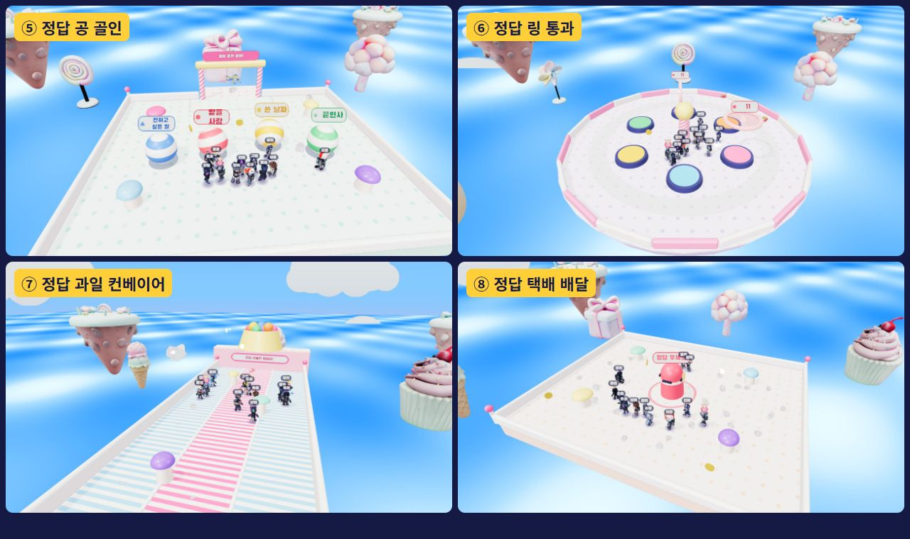
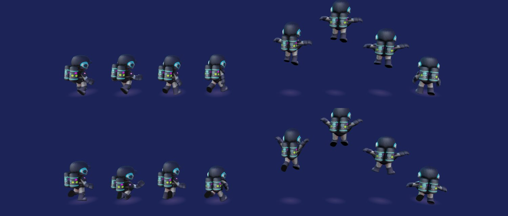
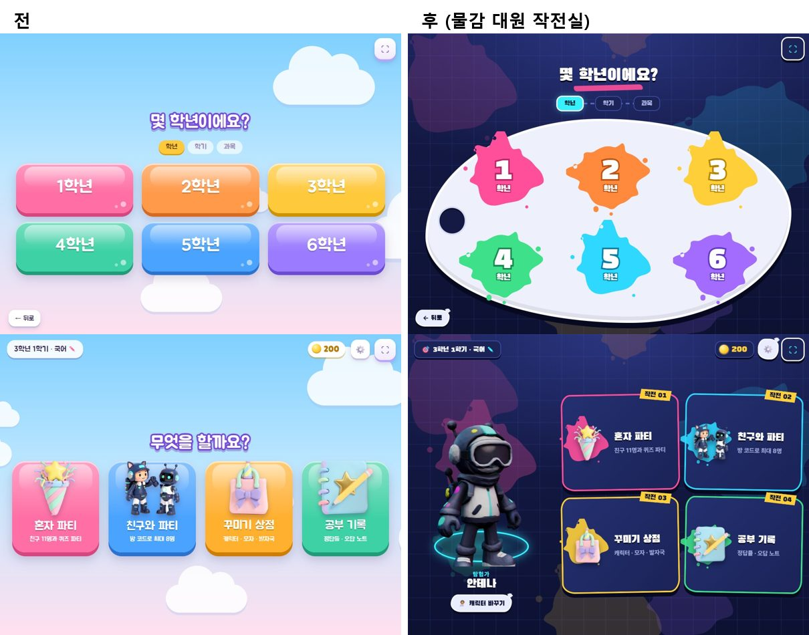
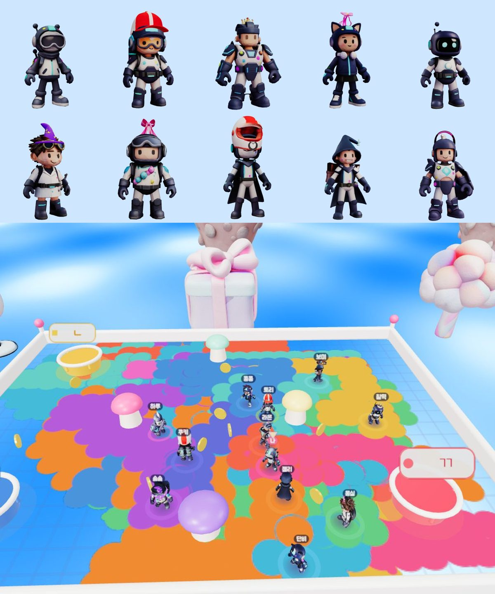

# 수정 기록

플레이해 보고 고친 것을 날짜순으로 적는다(최신이 위). 코드가 정확히 어떻게 바뀌었는지는 각 항목의 PR에서 **Files changed** 탭을 누르면 줄 단위로 볼 수 있다.

---

## 2026-11-05 · 모드 고르고 넘어갈 때 캐릭터 화면이 먼저 비치던 것

### 받은 피드백
> 맵 고르고 넘어갈 때 순간적으로 캐릭터 선택창이 잠시 뜨는 문제가 있어. 그거 수정해.

### 원인과 고친 것
- 모드 고르기와 캐릭터 고르기는 같은 화면(`scr-pick`)을 같이 쓴다. "선택!"을 누르면 캐릭터 카드를 **바로** 그려 넣고, 그다음에 물감 전환이 시작돼서 0.4초쯤 캐릭터 카드가 맨 화면에 비쳤다.
- `js/main.js`의 `go()`에 `fill`을 더했다. 화면 내용을 물감이 다 덮은 순간(0.4초)에 채운다. 모드 화면과 캐릭터 화면이 이것을 쓴다. 캐릭터 그림은 모드 화면을 열 때 미리 만들어 둔다.
- 판 번호 20261105c.

### 확인한 것
- "선택!"을 누른 뒤 0~0.4초에는 모드 카드 그대로, 0.46초부터 캐릭터 카드(물감이 덮고 있을 때). "파티 시작!"으로 라운드가 시작되고 오류 없음.

---

## 2026-11-05 · 미니게임 4종 추가 (공 골인 · 링 통과 · 과일 컨베이어 · 택배 배달)

### 받은 피드백
> 안에 들어가는 미니 게임이 총 4종인데 캐주얼하게 (문제 풀이와 함께 갈 수 있도록) 미니게임 4개를 더 추가해. fall guys 나 human fall flat 참고해서 제작해.

### 만든 것
두 게임에서 **장르의 흔한 놀이 방식**(공 밀기, 고리 통과, 거꾸로 흐르는 길, 물건 들고 나르기)만 빌렸다. 맵·이름·모양은 따라 하지 않았다. 지금 있는 라운드는 대부분 "정답 자리로 가기"라서, 새 라운드는 **몸으로 하는 일을 하나씩 다르게** 했다.

| 라운드 | 몸으로 하는 일 | 문제와 묶는 방법 | 별 |
|---|---|---|---|
| ⑤ ⚽ 정답 공 골인 | **밀기**: 보기가 적힌 큰 말랑 공을 여럿이 밀어 골대에. 다이브로 밀면 세게 굴러간다 | 정답 공만 골인. 틀린 공은 골대가 "퉤" 뱉는다 | 골인 전 5초 안에 민 사람 +2, 넣은 사람 +3 |
| ⑥ ⭕ 정답 링 통과 | **통과하기**: 낮은 고리는 섬 둘레를 천천히 돌고, 높은 고리는 트램펄린 위에 누워 있다(밟고 튀어 올라 통과) | 정답 고리를 지나가면 정답. 틀린 고리는 띠용 튕겨 낸다 | 먼저 통과한 순서 +3/+2/+1 |
| ⑦ 🍓 정답 과일 컨베이어 | **거꾸로 달리기**: 뒤로 흐르는 3줄 길(가운데가 빠르다). 앞 과일 통에서 과일이 퐁퐁 튀어나와 굴러온다 | 정답 과일만 냠. 틀린 과일에 부딪히면 뒤로 데굴. 떨어져도 다시 올라온다 | 정답 과일 +2, +1 (문제당 2개까지) |
| ⑧ 📦 정답 택배 배달 | **들고 나르기**: 닿으면 머리 위로 번쩍(조금 느려짐). 든 친구에게 다이브하면 떨어뜨리고, 들고 다이브하면 앞으로 던진다 | 정답 택배를 가운데 우체통에. 틀리면 "반송!". 정답 택배는 문제마다 3개뿐 | 배달 1등 +3, 그다음 +2 |

- **파티 쇼:** 결승(왕관 구름 계단)만 빼고 7종 중 3개를 섞는다. 새 라운드가 1~2개는 꼭 들어간다. 길이는 그대로 약 8분이다.
- **라운드 연습:** 고르기 화면과 친구와 파티의 방장 모드에 새 라운드 4개가 생겼다(모두 9가지).
- **봇:** 봇이 새 라운드도 한다. 공 뒤로 돌아가서 골대 쪽으로 밀고, 고리가 오는 길목에서 기다리고, 틀린 과일을 옆 줄로 피하고, 정답 택배를 든 사람을 쫓아가 다이브한다.
- **친구와 파티:** 문제 시작과 끝은 방장이 알린다. 공이 어디 있는지, 누가 어떤 택배를 들었는지도 방장이 정한다. 친구 기기는 "주울게요·놓을게요·넣을게요"를 부탁하고, 방장이 정한 결과를 모두가 받는다. 고리·과일 자리는 같은 씨앗과 문제 시작 뒤 흐른 시간으로 정해서 기기마다 같다.
- **대기실:** 모드 단추가 두 줄이 되어 자리 칸을 납작하게 했다(1280×720에서 "모두 출발!"이 화면 안에 들어온다). 작은 화면에서는 오른쪽이 스크롤된다.

### 바뀐 파일
| 파일 | 바뀐 것 |
|---|---|
| `js/rounds/quizloop.js` | 새 파일: 새 라운드 4종이 함께 쓰는 문제 진행(쉬는 틈 → 문제 → 정답 공개, 친구와 할 때 방장이 시작·끝 알림) |
| `js/rounds/ball.js` · `hoops.js` · `belt.js` · `parcel.js` | 새 라운드 4종 (무대·규칙·봇·친구 동기화) |
| `js/data/game.js` | 라운드 목록에 4종 추가 |
| `js/game/party.js` | 불러오기·문제 수(각 5개)·파티 쇼 순서 |
| `js/main.js` | 파티 쇼 설명, 무대 사진 찍기(`__app.shots`)가 새 라운드도 찍음 |
| `style.css` | 대기실 자리 칸·단추 크기 |
| `assets/images/round_ball.jpg` 등 4장 | 모드 고르기 카드 그림 |

### 확인한 것
- 4종 모두 봇 자동 플레이로 처음부터 결과 화면까지. 오류 없음. 한 판 약 1분~1분 40초.
- 파티 쇼 2번: 순서가 섞이고 새 라운드가 들어가고, 결승이 마지막. 결과 화면까지 갔다.
- 두 탭 친구와 파티: 공 골인은 두 화면의 공 위치가 같고 친구 별도 같다. 택배 배달은 친구가 줍기 3번·배달 1번을 방장 확인으로 해냈다. 문제 번호도 두 화면이 같다.
- 처음에 고친 것: 친구 기기가 자기가 주운 택배 소식을 버리는 문제. 이벤트에 사람 번호를 `pid`로 넣어서 보낸 사람 번호를 덮어썼다. `pp`로 바꿨다. 또 과일 컨베이어에서 앞 벽에 붙어 버티면 과일을 다 잡을 수 있어서, 벽을 통통 튕기게 하고 과일을 몇 걸음 앞에 떨어지게 했다.

### 직접 확인하는 법
1. https://dew978.github.io/mallang-quiz-party/ 를 연다(태블릿은 새로고침).
2. 혼자 파티 → 모드 고르기에서 ⚽ ⭕ 🍓 📦 중 하나 → 한 판.
3. 바로 열기: 주소 뒤에 `?play=ball`, `?play=hoops`, `?play=belt`, `?play=parcel`.

### 조절하고 싶으면
- 문제 시간: 각 파일의 `new QuizLoop(this, { extra: … })`(학년별 기본 시간에 더하는 초). 공 골인 13, 택배 12, 링 4, 과일 3.
- 공: `ball.js`의 `R`(크기), `FRICTION`(멈추는 빠르기), `GW`(골대 너비). 고리: `hoops.js`의 `HR`(크기), `HIGH_Y`(높은 고리 높이), `PAD_V`(트램펄린 세기). 과일: `belt.js`의 `SPEED`(줄 속도), `EVERY`(나오는 간격), `MAX_CATCH`. 택배: `parcel.js`의 `COPIES`(보기마다 상자 수), `CARRY_SPEED`.
- 파티 쇼에 새 라운드가 몇 개 들어갈지: `js/game/party.js`의 `nFresh`.

---

## 2026-11-05 · 캐릭터 걷기·달리기·점프 동작

### 받은 피드백
> 캐릭터 걷는 모션 점프하는 모션 없이 그냥 덩어리로 움직이는거 수정해

### 왜 그랬나
- 뼈는 돌고 있었는데 너무 작게 돌았다. 레이더스 인형은 다리가 짧고 팔이 몸에 붙어 있어서, 허벅지를 0.8만큼 흔들어도 멀리서는 발끝만 살짝 움직였다. 몸도 거의 위아래로 안 움직여서 통째로 미끄러지는 것처럼 보였다.
- 공중 자세는 하나뿐이라(팔 벌리고 한쪽 무릎) 오를 때와 떨어질 때가 똑같았다.
- 착지할 때 무릎을 굽히지 않았다.

### 고친 내용 (`js/engine/figure.js`)
- **걷기·달리기를 나눔:** 천천히 가면 걷기(보폭 작게, 몸을 좌우로 기우뚱), 빠르면 달리기(보폭 크게, 앞으로 숙이고, 팔을 크게 흔듦).
- **다리:** 보폭을 키우고, 앞으로 나가는 다리는 무릎을 굽혀 들어 올리고, 달릴 때는 뒤로 간 다리의 발꿈치를 차올린다. 게임 카메라(뒤쪽)에서 발바닥이 번갈아 보인다.
- **몸:** 발이 모일 때마다 통 튀어 오르고, 디딜 때 살짝 찌그러지고, 디딘 다리 쪽으로 기우뚱, 허리를 좌우로 비튼다.
- **점프 3단계:** 오를 때는 한 무릎을 번쩍 들고 두 팔을 V자로 올리고 몸이 길쭉해진다 → 꼭대기에서는 무릎을 당겨 웅크리고 팔을 옆으로 → 떨어질 때는 다리를 내리고 팔을 파닥파닥. 뛸 때마다 드는 다리를 바꾼다.
- **착지:** 무릎을 굽혀 쿵 받고 몸이 납작해졌다 돌아온다(높이 떨어질수록 깊게).
- 자세가 바뀔 때 툭 끊기지 않게 부드럽게 넘어간다.
- 친구와 할 때 다른 친구 캐릭터도 같은 동작을 한다(뛰어오름·착지를 그리는 쪽에서 직접 잰다).

### 직접 확인하는 법
1. https://dew978.github.io/mallang-quiz-party/ 를 연다(태블릿은 새로고침).
2. 혼자 파티 → 정답 문 대시에서 달려 보고 점프(Space·점프 단추)를 눌러 본다. 다른 캐릭터들이 뛰는 모습도 본다.

### 조절하고 싶으면 (`js/engine/figure.js`의 `update`)
- 보폭: `const A = (0.6 + 0.5 * rr) * w` · 무릎 들기: `knee` · 발꿈치 차기: `kick`
- 통통 튀는 높이: `bob = hop * hop * (0.06 + 0.1 * rr) * w` · 기우뚱: `rollT` · 허리 비틀기: `yawT`
- 점프 자세: `// 공중:` 아래 숫자들 · 착지 깊이: `LAND_T`(시간), `T.llL -= 1.4 * lk`(무릎)

---

## 2026-11-04 · UI 새로: "물감 대원 작전실"

### 받은 피드백
> 너무 ui를 Q-racer와 흡사하게 제작해서 참신함이 너무 떨어져

> ui 개선은?

### 전에는
- Q-레이서와 뼈대가 같았다: 하늘색 파스텔 바탕과 구름, 분홍·파랑 사탕 알약 단추, 학년·학기·과목을 무지개색 반짝이 카드로 고르기, 메뉴 4칸 카드, 띠가 지나가는 화면 전환, Jua 글꼴.
- 파스텔 사탕 느낌이라 새 레이더스 캐릭터(남색·네온)와도 어울리지 않았다.

### 고친 내용
- **바탕·색:** 남색 작전실 바탕에 격자와 흐릿한 물감 자국. 포인트 색은 네온 하늘색과 물감 6색(분홍·주황·노랑·초록·하늘·보라).
- **글꼴:** Black Han Sans(제목·단추)와 Pretendard(문제·설명). 미니 유물레이더스와 같은 글꼴이고, 인터넷 글꼴 대신 `vendor/fonts/`에 넣어 인터넷이 느려도 바로 뜬다. 3D 판 글자(문 보기·문제판·이름표)도 같은 글꼴로 바꿨다.
- **단추:** 흰 테두리와 딱딱한 그림자가 있는 물감 스티커 모양. 모서리가 살짝 삐뚤고, 구석에 물감 방울이 튀어 있다.
- **화면 전환:** 띠 대신 물감 세 방울이 확 퍼져 덮었다가 걷힌다.
- **학년:** 팔레트 위 물감 방울 6개. **학기:** 물감통 2개(위로 물감이 흘러내림). **과목:** 바느질 테두리가 있는 대원 배지. 누르면 퐁 튀고 넘어간다.
- **메뉴:** 왼쪽에 내 캐릭터가 3D로 네온 받침대 위에 서 있다(끌면 돌고, 누르면 손을 번쩍). 오른쪽은 "작전 01~04" 테이프가 붙은 작전 카드 4장.
- **경기 화면:** 문제 카드·정답 알림·라운드 소개·카운트다운·별·멈춤 단추를 남색 판 + 네온 테두리로. 터치 단추와 조이스틱도 같은 색.
- 그 밖의 화면(고르기·상점·설정·공부 기록·친구와 파티·별판·결과·문제 창)도 같은 남색 패널로 맞췄다.
- 타이틀의 로고·단추 **위치는 그대로**다(로고는 버튼 바로 위, 버튼은 화면 중간 아래). 모양만 바꿨다: "말랑"은 노란 테이프, "퀴즈파티"는 남색 테두리 물감 글자, 단추 뒤에 물감이 튄다.

### 바뀐 파일
| 파일 | 바뀐 것 |
|---|---|
| `style.css` | 전부 새로 (클래스 이름은 그대로라 게임 코드는 그대로 돈다) |
| `index.html` | 인터넷 글꼴 대신 내장 글꼴, 메뉴에 3D 캐릭터 자리·작전 번호 |
| `js/main.js` | 학년 팔레트·학기 물감통·과목 배지 만들기, 메뉴 3D 캐릭터 켜고 끄기, 글꼴을 다 받은 뒤 시작 |
| `js/ui/showcase.js` | 새 파일: 메뉴의 3D 캐릭터 |
| `assets/ui/splat1.svg`, `splat2.svg`, `blob.svg` | 물감 모양 (단추·전환·배경에 마스크로 씀) |
| `vendor/fonts/` | Black Han Sans, Pretendard (OFL) |
| `js/engine/labels.js`, `figure.js`, `js/rounds/doors.js`, `tiles.js`, `tower.js` | 3D 글자 글꼴 |

### 직접 확인하는 법
1. https://dew978.github.io/mallang-quiz-party/ 를 연다(태블릿은 새로고침).
2. 시작하기 → 학년 팔레트 → 학기 물감통 → 과목 배지 → 메뉴(왼쪽 3D 캐릭터를 끌어 본다) 순서로 넘어가며 본다.
3. 혼자 파티로 한 판 하면서 문제 카드와 결과 화면을 본다.

### 아직 그대로인 것
- 경기 속 3D 무대(사탕 섬·젤리 바다·분홍 문제판)는 그대로 파스텔이다. 원하면 무대 색도 작전실 쪽으로 바꿀 수 있다.

### 조절하고 싶으면 (`style.css` 맨 위 `:root`)
- 바탕 남색: `--bg0`, `--bg1`, `--panel` · 네온: `--neon` · 물감 색: `--pink`, `--yellow`, `--cyan`, `--green`, `--purple`, `--orange`
- 메뉴 3D 캐릭터 크기·위치: `js/ui/showcase.js`의 `resize()` (`FIG_H * 1.25`가 화면에 보이는 높이)

---

## 2026-11-04 · 풍선 사냥 → 물감 땅따먹기, 캐릭터를 레이더스 스타일로

### 받은 피드백
> 지금게임도 살려두고 말랑 퀴즈 게임 중 정답 풍선 사냥은 너무 어려워서 그것만 다른걸로 교체하자.

> 그리고 캐릭터 디자인 너무 별로야.... 애매해... 미니레이더스 캐릭터들 차용하고, 그런 스타일로 추가 제작해서 쓰자.

### 전에는
- ③ 라운드 **정답 풍선 사냥**: 떠다니는 풍선에 몸으로 부딪혀 터뜨렸다. 높은 풍선은 귀퉁이 트램펄린으로 올라가야 했고, 풍선이 계속 움직여서 맞히기 어려웠다.
- 캐릭터 6종은 팔다리 없는 동그란 말랑이(토끼·곰·병아리·고양이·공룡·판다)에 손발을 코드로 붙인 모습이었다.

### 고친 내용
- **③ 정답 물감 땅따먹기** (`js/rounds/paint.js`): 평평한 광장 귀퉁이에 보기 물감통이 놓인다. 정답 통에 뛰어들면 내 색 물감이 묻어 몇 초(1등 9초, 2등 8초, 그 뒤 7초) 동안 달리는 곳마다 바닥이 내 색이 된다. 남이 칠한 곳도 덮어 칠할 수 있다. 점프·낭떠러지가 없어서 쉽다.
  - 별: 정답 순서대로 +3·+2·+1, 마지막에 넓게 칠한 1·2·3등 +4·+3·+2. 오답은 맹물(0.9초 어지러움). 문제 6개는 그대로.
  - 발밑 색 고리로 내 색을 알 수 있고, 오른쪽 위에 "내 땅 몇 %·몇 등"이 뜬다.
- **캐릭터 10종** (`js/engine/figure.js`, `js/data/game.js`): 미니 유물레이더스의 대원 5종(뼈대 있는 모델)을 가져오고, 같은 스타일로 로봇·발명가·마법사·고양이 후드·꼬마 기사 5종을 새로 만들었다(ComfyUI → TRELLIS → 블렌더 뼈 심기). 뼈를 돌려 달리기·점프·다이브·넘어짐·어지러움·기쁨 자세를 만들고, 모자는 머리뼈에 붙는다.
  - 기본 캐릭터: 안테나·방울·단단·냥냥. 예전 말랑이를 산 저장 데이터는 산 값(400)을 코인으로 돌려준다.
- 타이틀 그림, "친구와 파티" 아이콘, 모드 카드 사진도 새 캐릭터로 다시 만들었다.

### 바뀐 파일
| 파일 | 바뀐 것 |
|---|---|
| `js/rounds/paint.js` | 새 라운드 (풍선 `balloons.js`는 지움) |
| `js/engine/figure.js` | 새 캐릭터 그리기·자세 (`mallang.js`는 지움) |
| `js/data/game.js`, `js/save.js` | 캐릭터 목록·가격, 라운드 목록, 예전 저장 데이터 옮기기 |
| `js/game/party.js`, `js/game/session.js`, `js/ui/portrait.js`, `js/main.js` | 새 라운드·캐릭터 연결 |
| `assets/models/char_*.glb` | 캐릭터 10종 (+ 가벼운 `_lod`) |
| `assets/images/title.png`, `icon_friends.png`, `round_*.jpg` | 새 캐릭터로 다시 그림 |
| `tools/rig_chars.py`, `tools/char_prompts.py` | 캐릭터를 더 만들 때 쓰는 원화 프롬프트·뼈 심기 |

### 직접 확인하는 법
1. https://dew978.github.io/mallang-quiz-party/ 를 연다(태블릿은 새로고침).
2. 상점 → 캐릭터에서 10종이 보이는지, 모자를 씌워 보는지 본다.
3. 혼자 파티 → 라운드 연습 → 정답 물감 땅따먹기. 정답 통에 뛰어든 뒤 바닥이 내 색으로 칠해지는지 본다.
   주소 뒤에 `?play=paint&demo`를 붙이면 바로 시작해서 봇처럼 저절로 움직인다.

### 친구와 하기
- 두 탭으로 시험했다: 같은 자리의 물감통, 정답 고르기·별 동기화, 방장이 넓이 순위·끝을 정하고 양쪽 결과 화면까지 갔다.
- 칠한 바닥은 기기마다 받은 위치로 따로 그려서 조금 다를 수 있다. 넓이 보너스 별은 방장 기기 기준이다.
- 실제 태블릿 여러 대로는 아직 해 보지 않았다.

### 조절하고 싶으면 (`js/rounds/paint.js` 맨 위)
- 칠하는 시간: `PAINT_T = [9, 8, 7]` (정답 1등·2등·그 뒤, 초)
- 붓 크기: `BRUSH = 1.15` (반지름, 칸 하나 = 1)
- 넓이 보너스 별: `AREA_BONUS = [4, 3, 2]`
- 캐릭터 키: `js/engine/figure.js`의 `FIG_H = 1.38`

---

## 2026-11-04 · 타이틀 화면: 로고 크게, 버튼은 중간 아래, 글자 가운데

PR: [dew978/mallang-quiz-party#3](https://github.com/dew978/mallang-quiz-party/pull/3)

### 받은 피드백
> 메인 화면 UI 다듬자. 버튼 위치 조금 더 내려서 화면 중간보다 밑에 위치하게 해. 버튼 속 글자들 크기 키우고 버튼 가운데로 정렬해.

> 말랑 퀴즈 파티 글자 크기 키우고 버튼과 글자 사이 빈공간 줄여.

### 전에는
- 로고("말랑 퀴즈파티")는 맨 위에 작게(퀴즈파티 104px, 말랑 54px) 있었다.
- 시작하기·설정 버튼은 로고 바로 아래에 붙어 있었다. 버튼 윗변이 화면 높이의 28%, 38%로 둘 다 중간보다 위였다.
- 버튼 글자는 28px이고, 실제 글자 높이가 버튼 높이의 1/3 정도라 작아 보였다.
- 버튼 글자가 위로 9px 치우쳐 있었다(위 여백 19px, 아래 28px). 안쪽 여백이 위아래 달랐고(16px/19px), Jua 글꼴은 글자가 위쪽에 붙어 있어서다.

### 고친 내용
- **버튼:** 윗변이 **화면 높이의 54%**에서 시작한다. 화면 높이에 맞춰 커진다(글자 30~44px, 버튼 높이 66~96px, 너비 280~360px). 위아래 여백을 맞추고 Jua가 위로 뜨는 만큼 위 여백을 조금 더 줘서, 글자가 버튼 한가운데에 온다.
- **로고:** 화면 높이에 맞춰 약 1.5배로 커졌다(퀴즈파티 = 화면 높이의 18%, 말랑 = 9%). 버튼 묶음 **바로 위**에 붙어서, 로고와 버튼 사이가 화면 높이의 4% 정도만 남는다.
- 바꾼 건 **타이틀 화면만**이다. 로딩 화면의 작은 로고와 다른 화면의 큰 버튼은 그대로다.

### 바뀐 파일
| 파일 | 바뀐 것 |
|---|---|
| `style.css` | `/* ---- 타이틀 ---- */` 부분의 `.title-wrap`, `.title-btns`, `#scr-title .title-btns .btn`, `#scr-title .logo` |

### 직접 확인하는 법
1. https://dew978.github.io/mallang-quiz-party/ 를 연다(태블릿은 새로고침).
2. 첫 화면에서 로고가 커졌는지, 버튼 두 개가 화면 중간 아래에서 로고 바로 밑에 있는지, 버튼 글자가 커지고 가운데에 있는지 본다.

### 조절하고 싶으면 (`style.css` 타이틀 부분)
- 버튼 위치: `.title-btns`의 `top: 54%`. 숫자가 클수록 아래로 간다. 로고는 버튼에 붙어 있어서 같이 움직인다.
- 버튼 글자 크기: `#scr-title .title-btns .btn`의 `font-size: clamp(30px, 4.6vh, 44px)`. 가운데 숫자(화면 높이의 4.6%)를 키우면 커진다. 앞뒤 숫자는 최소·최대 크기다.
- 버튼 크기: 같은 곳의 `height`(높이), `min-width`(너비).
- 버튼 글자 위아래 위치: 같은 곳의 `padding: 0.2em 44px 0`에서 `0.2em`. 키우면 글자가 내려간다.
- 로고 크기: `#scr-title .logo .l2 b`(퀴즈파티)의 `18vh`, `#scr-title .logo .l1`(말랑)의 `9vh`. 키우면 커진다.
- 로고와 버튼 사이: `#scr-title .logo`의 `bottom: calc(46% + clamp(16px, 4vh, 40px))`에서 `4vh`. 줄이면 더 붙는다.

### 점검한 것
헤드리스 브라우저에서 Jua 글꼴을 실제로 받아 네 가지 화면 크기로 찍고 쟀다.

| 화면 | 로고(퀴즈파티) | 로고와 버튼 사이 | 버튼 글자 | 버튼 윗변 | 버튼 글자 위·아래 여백 차이 |
|---|---|---|---|---|---|
| 1836×886 (보내 준 화면) | 104 → 159px | 287 → 38px | 28 → 41px | 54% | 1px |
| 1280×800 | 104 → 144px | 244 → 34px | 28 → 37px | 54% | 0~1px |
| 1024×768 (태블릿) | 104 → 138px | 229 → 33px | 28 → 35px | 54% | 0~1px |
| 1366×640 (낮은 노트북 창) | 84 → 115px | 192 → 27px | 24 → 30px | 54% | 1~2px |

- 클릭과 터치 모두에서 시작하기 → 학년 고르기, 설정 → 설정 화면으로 넘어가는 것을 확인했다.
- 네 화면 크기 모두에서 로고·버튼이 배경 캐릭터와 겹치지 않는다.

---

## 2026-11-04 · 저화질에서 말랑이·모자·소품이 검게 나오던 버그

PR: [dew978/mallang-quiz-party#2](https://github.com/dew978/mallang-quiz-party/pull/2)

### 증상
- 그래픽 설정이 **가볍게 (태블릿)**(저화질)이면 말랑이, 모자, 소품(막대사탕·컵케이크 등), 떠 있는 섬, 왕관이 모두 새까만 그림자처럼 나왔다.
- 손·발, 무대, 문, 글자는 정상이었다.
- 터치 기기(태블릿·폰)는 처음 켜면 저화질이 기본이라, 교실 태블릿에서 그대로 이렇게 보였을 가능성이 크다. PC는 고화질이 기본이라 티가 안 났다.

### 원인
- 모델 파일 25개(TRELLIS로 만든 GLB)에는 모두 **법선**(면이 어느 쪽을 보는지) 데이터가 없다.
- 고화질에서는 three.js의 모델 불러오는 코드(GLTFLoader)가 이걸 알아채고 `flatShading`을 켜 둔다. 그러면 화면에서 면 방향을 계산하니 정상으로 보인다.
- 저화질에서는 가벼운 재질(`MeshLambertMaterial`)로 바꿔 끼우는데, 이때 `flatShading`을 옮기지 않았다. 법선이 없는 채로 그려지니 빛을 하나도 못 받아 검게 나왔다.

### 고친 내용
- 저화질 재질로 바꿀 때 `flatShading` 등 원래 재질 설정을 그대로 옮긴다. 고화질은 바뀐 게 없다.

### 바뀐 파일
| 파일 | 바뀐 것 |
|---|---|
| `js/engine/assets.js` | 저화질 재질로 바꾸는 한 줄에 `flatShading` 등을 추가. 모든 모델이 이 함수(`loadGLB`)를 거쳐서 게임 속 말랑이·모자·소품, 메뉴의 캐릭터 카드까지 함께 고쳐진다. |

### 직접 확인하는 법
1. 사이트를 열고 **설정 → 그래픽 → "가볍게 (태블릿)"**을 고른다(태블릿이면 원래 이 설정).
2. **새로고침**한다. 모델 색은 처음 불러올 때 정해져서, 설정을 바꾼 뒤 새로고침해야 모델에 적용된다. 태블릿도 새로고침해야 새 버전이 뜬다.
3. 아무 라운드나 시작하면(예: 주소 끝에 `?play=doors`) 말랑이와 모자가 제 색으로 보인다.

### 점검한 것
- 컴퓨터의 헤드리스 브라우저에서 저화질로 정답 문 대시를 돌려, 고치기 전후 같은 장면을 찍어 비교했다. 오류는 없었다.
- 모델 25개 모두 법선이 없고 `flatShading`이 켜져 있는 것을 확인했다. 그래서 이 수정이 25개 전부에 적용된다.

---

## 2026-11-04 · 카메라가 장애물에 걸려 보이던 문제

PR: [dew978/mallang-quiz-party#1](https://github.com/dew978/mallang-quiz-party/pull/1)

### 받은 피드백
> 카메라가 물리법칙이 적용돼서 캐릭터를 따라가다가 앞 장애물에 걸리는 현상. 카메라는 물리법칙·장애물을 무시하고 계속 따라가야 하고, 캐릭터와 카메라 사이에 장애물이 있으면 안 보이게 해야 함. (사라진 장애물은 카메라에만 안 보이고, 다른 캐릭터에게는 계속 영향을 줘야 함)

### 원인
- 카메라에는 원래 충돌(물리)이 없었다. 캐릭터 뒤 위쪽에서 그냥 따라간다.
- 그런데 **정답 문 대시**에서 카메라 높이(6.4)와 벽 위 문제판 높이(4.7~7.0)가 겹쳤다.
  캐릭터가 문을 지나면 벽과 문제판이 카메라와 캐릭터 사이에 끼고, 카메라가 문제판을 그대로 뚫고 지나가면서 화면을 가렸다.
  그래서 카메라가 장애물에 걸린 것처럼 보였다.
- 결승(구름 계단)에서도 위층에 올라서면 그 층 뒤쪽의 문제판이 캐릭터를 가렸다.

### 게임에서 달라진 점
- 카메라와 **내 말랑이** 사이에 낀 무대 물체는 **내 화면에서만** 안 보인다. 지나가고 나면 다시 보인다.
  - 문 벽 한 줄(기둥·문·문제판), 회전 막대의 가운데 기둥, 흔들 추의 틀, 통통 기둥, 사탕 블록, 젤리 발판 가운데 시계탑 등.
- 숨겨져도 **충돌은 그대로**다. 친구·봇은 계속 부딪히고, 그림자도 남는다. 친구 화면에는 그대로 보인다.
- 일부러 **숨기지 않는 것**: 회전 막대, 흔들리는 추 공(피해야 하니까), 정답 풍선, 왕관, 동전(잡아야 하니까), 젤리 발판 시계 숫자.
- 발밑 바닥, 발끝만 살짝 가리는 낮은 턱이나 트램펄린은 숨기지 않는다.
- 카메라가 따라가는 위치와 속도는 그대로다.

왼쪽(전)은 벽을 지나자 문제판이 화면을 덮는다. 오른쪽(후)은 지나온 벽이 사라져 내 말랑이와 앞길이 보인다.

### 바뀐 파일
| 파일 | 바뀐 것 |
|---|---|
| `js/engine/occlusion.js` (새 파일) | 가리는 물체 찾기·숨기기. 매 프레임 카메라에서 내 말랑이 몸통(4점)과 카메라 바로 앞(5방향)으로 광선을 쏴서, 맞은 무대 덩어리를 숨긴다. 재질의 그리기만 꺼서 충돌·그림자는 그대로다. |
| `js/game/session.js` | 카메라를 움직인 뒤 위 기능을 부르고(`updateCamera`), 판이 끝나면 정리한다(`dispose`). |
| `js/rounds/common.js` | 회전 막대·흔들 추 공·동전은 숨기지 않도록 표시(`camKeep`). |
| `js/rounds/balloons.js` | 정답 풍선은 숨기지 않도록 표시. |
| `js/rounds/tower.js` | 왕관은 숨기지 않도록 표시. |
| `js/rounds/tiles.js` | 가운데 시계 숫자는 숨기지 않도록 표시. |
| `README.md`, `docs/이어서-작업하기.md`, `docs/제작과정.md` | 설명 추가. |

### 직접 확인하는 법
1. https://dew978.github.io/mallang-quiz-party/ 를 연다. 태블릿·폰은 **새로고침**해야 새 버전이 뜬다(안 바뀌면 브라우저 캐시를 지우거나 시크릿 창).
2. 바로 확인하려면 주소 끝에 `?play=doors`(정답 문 대시)나 `?play=tower`(결승)를 붙인다.
3. 첫 번째 벽을 지나 보면, 예전처럼 문제판이 화면을 덮지 않고 지나온 벽이 사라진다.

### 조절하고 싶으면
- `js/engine/occlusion.js` 맨 위 숫자들:
  - `HOLD` — 가림이 풀린 뒤 다시 보일 때까지 기다리는 시간(초). 깜빡이면 늘린다.
  - `BODY_PTS` — 말랑이 몸의 어느 높이를 가리면 숨길지. 더 쉽게 숨기려면 낮은 점을 추가한다(예: `[0, 0.25]`).
  - `FLOOR_PAD` — 이 높이보다 낮은 물체는 바닥으로 보고 숨기지 않는다.
- 어떤 물체를 절대 숨기지 않으려면, 그 물체를 만드는 곳에서 `물체.userData.camKeep = true`를 붙인다.

### 점검한 것과 남은 것
- 컴퓨터의 헤드리스 브라우저에서 4라운드를 모두 봇 조종으로 끝까지 돌렸고 오류가 없었다. 저화질(태블릿 기본) 모드에서도 동작을 확인했다.
- 추가로 드는 계산은 프레임당 평균 약 0.1ms(그 컴퓨터 기준)다. **실제 태블릿에서는 아직 재 보지 않았다.**
- 이번 수정과 별개로 저화질에서 말랑이·섬이 검게 나오는 것을 발견했다. 수정 전부터 있던 버그였고, 바로 위 항목(#2)에서 고쳤다.
