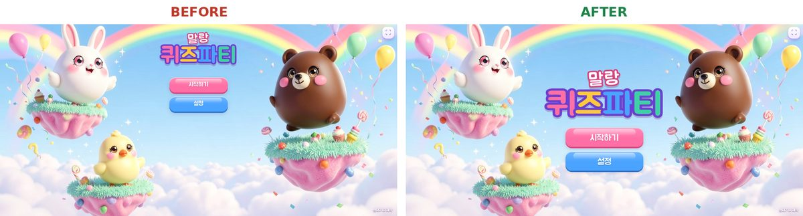
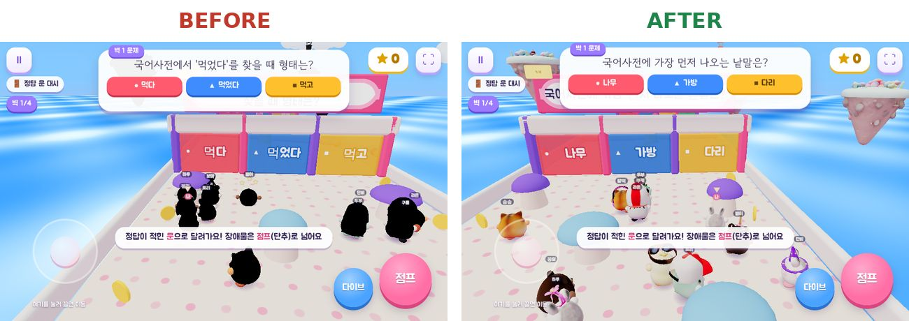
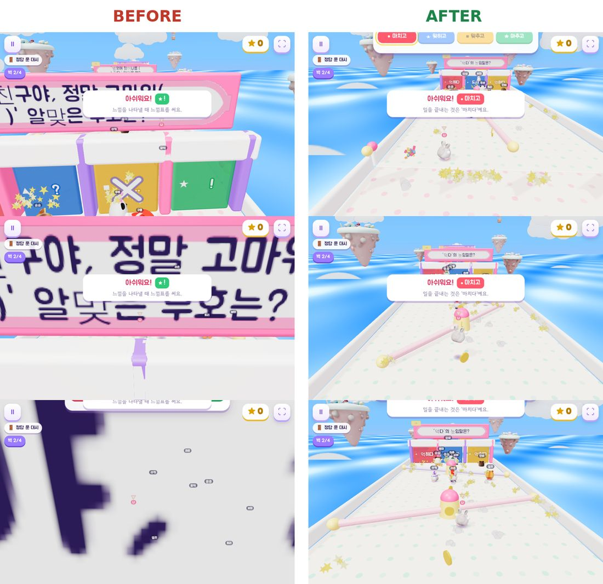

# 수정 기록

플레이해 보고 고친 것을 날짜순으로 적는다(최신이 위). 코드가 정확히 어떻게 바뀌었는지는 각 항목의 PR에서 **Files changed** 탭을 누르면 줄 단위로 볼 수 있다.

---

## 2026-11-04 · 타이틀 화면: 로고 크게, 버튼은 중간 아래, 글자 가운데

PR: [dew978/mallang-quiz-party#3](https://github.com/dew978/mallang-quiz-party/pull/3)

### 받은 피드백
> 메인 화면 UI 다듬자. 버튼 위치 조금 더 내려서 화면 중간보다 밑에 위치하게 해. 버튼 속 글자들 크기 키우고 버튼 가운데로 정렬해.

> 말랑 퀴즈 파티 글자 크기 키우고 버튼과 글자 사이 빈공간 줄여.

### 전에는
- 로고("말랑 퀴즈파티")는 맨 위에 작게(퀴즈파티 104px, 말랑 54px) 있었다.
- 시작하기·설정 버튼은 로고 바로 아래에 붙어 있었다. 버튼 윗변이 화면 높이의 28%, 38%로 둘 다 중간보다 위였다.
- 버튼 글자는 28px이고, 실제 글자 높이가 버튼 높이의 1/3 정도라 작아 보였다.
- 버튼 글자가 위로 9px 치우쳐 있었다(위 여백 19px, 아래 28px). 안쪽 여백이 위아래 달랐고(16px/19px), Jua 글꼴은 글자가 위쪽에 붙어 있어서다.

### 고친 내용
- **버튼:** 윗변이 **화면 높이의 54%**에서 시작한다. 화면 높이에 맞춰 커진다(글자 30~44px, 버튼 높이 66~96px, 너비 280~360px). 위아래 여백을 맞추고 Jua가 위로 뜨는 만큼 위 여백을 조금 더 줘서, 글자가 버튼 한가운데에 온다.
- **로고:** 화면 높이에 맞춰 약 1.5배로 커졌다(퀴즈파티 = 화면 높이의 18%, 말랑 = 9%). 버튼 묶음 **바로 위**에 붙어서, 로고와 버튼 사이가 화면 높이의 4% 정도만 남는다.
- 바꾼 건 **타이틀 화면만**이다. 로딩 화면의 작은 로고와 다른 화면의 큰 버튼은 그대로다.

### 바뀐 파일
| 파일 | 바뀐 것 |
|---|---|
| `style.css` | `/* ---- 타이틀 ---- */` 부분의 `.title-wrap`, `.title-btns`, `#scr-title .title-btns .btn`, `#scr-title .logo` |

### 직접 확인하는 법
1. https://dew978.github.io/mallang-quiz-party/ 를 연다(태블릿은 새로고침).
2. 첫 화면에서 로고가 커졌는지, 버튼 두 개가 화면 중간 아래에서 로고 바로 밑에 있는지, 버튼 글자가 커지고 가운데에 있는지 본다.

### 조절하고 싶으면 (`style.css` 타이틀 부분)
- 버튼 위치: `.title-btns`의 `top: 54%`. 숫자가 클수록 아래로 간다. 로고는 버튼에 붙어 있어서 같이 움직인다.
- 버튼 글자 크기: `#scr-title .title-btns .btn`의 `font-size: clamp(30px, 4.6vh, 44px)`. 가운데 숫자(화면 높이의 4.6%)를 키우면 커진다. 앞뒤 숫자는 최소·최대 크기다.
- 버튼 크기: 같은 곳의 `height`(높이), `min-width`(너비).
- 버튼 글자 위아래 위치: 같은 곳의 `padding: 0.2em 44px 0`에서 `0.2em`. 키우면 글자가 내려간다.
- 로고 크기: `#scr-title .logo .l2 b`(퀴즈파티)의 `18vh`, `#scr-title .logo .l1`(말랑)의 `9vh`. 키우면 커진다.
- 로고와 버튼 사이: `#scr-title .logo`의 `bottom: calc(46% + clamp(16px, 4vh, 40px))`에서 `4vh`. 줄이면 더 붙는다.

### 점검한 것
헤드리스 브라우저에서 Jua 글꼴을 실제로 받아 네 가지 화면 크기로 찍고 쟀다.

| 화면 | 로고(퀴즈파티) | 로고와 버튼 사이 | 버튼 글자 | 버튼 윗변 | 버튼 글자 위·아래 여백 차이 |
|---|---|---|---|---|---|
| 1836×886 (보내 준 화면) | 104 → 159px | 287 → 38px | 28 → 41px | 54% | 1px |
| 1280×800 | 104 → 144px | 244 → 34px | 28 → 37px | 54% | 0~1px |
| 1024×768 (태블릿) | 104 → 138px | 229 → 33px | 28 → 35px | 54% | 0~1px |
| 1366×640 (낮은 노트북 창) | 84 → 115px | 192 → 27px | 24 → 30px | 54% | 1~2px |

- 클릭과 터치 모두에서 시작하기 → 학년 고르기, 설정 → 설정 화면으로 넘어가는 것을 확인했다.
- 네 화면 크기 모두에서 로고·버튼이 배경 캐릭터와 겹치지 않는다.

---

## 2026-11-04 · 저화질에서 말랑이·모자·소품이 검게 나오던 버그

PR: [dew978/mallang-quiz-party#2](https://github.com/dew978/mallang-quiz-party/pull/2)

### 증상
- 그래픽 설정이 **가볍게 (태블릿)**(저화질)이면 말랑이, 모자, 소품(막대사탕·컵케이크 등), 떠 있는 섬, 왕관이 모두 새까만 그림자처럼 나왔다.
- 손·발, 무대, 문, 글자는 정상이었다.
- 터치 기기(태블릿·폰)는 처음 켜면 저화질이 기본이라, 교실 태블릿에서 그대로 이렇게 보였을 가능성이 크다. PC는 고화질이 기본이라 티가 안 났다.

### 원인
- 모델 파일 25개(TRELLIS로 만든 GLB)에는 모두 **법선**(면이 어느 쪽을 보는지) 데이터가 없다.
- 고화질에서는 three.js의 모델 불러오는 코드(GLTFLoader)가 이걸 알아채고 `flatShading`을 켜 둔다. 그러면 화면에서 면 방향을 계산하니 정상으로 보인다.
- 저화질에서는 가벼운 재질(`MeshLambertMaterial`)로 바꿔 끼우는데, 이때 `flatShading`을 옮기지 않았다. 법선이 없는 채로 그려지니 빛을 하나도 못 받아 검게 나왔다.

### 고친 내용
- 저화질 재질로 바꿀 때 `flatShading` 등 원래 재질 설정을 그대로 옮긴다. 고화질은 바뀐 게 없다.

### 바뀐 파일
| 파일 | 바뀐 것 |
|---|---|
| `js/engine/assets.js` | 저화질 재질로 바꾸는 한 줄에 `flatShading` 등을 추가. 모든 모델이 이 함수(`loadGLB`)를 거쳐서 게임 속 말랑이·모자·소품, 메뉴의 캐릭터 카드까지 함께 고쳐진다. |

### 직접 확인하는 법
1. 사이트를 열고 **설정 → 그래픽 → "가볍게 (태블릿)"**을 고른다(태블릿이면 원래 이 설정).
2. **새로고침**한다. 모델 색은 처음 불러올 때 정해져서, 설정을 바꾼 뒤 새로고침해야 모델에 적용된다. 태블릿도 새로고침해야 새 버전이 뜬다.
3. 아무 라운드나 시작하면(예: 주소 끝에 `?play=doors`) 말랑이와 모자가 제 색으로 보인다.

### 점검한 것
- 컴퓨터의 헤드리스 브라우저에서 저화질로 정답 문 대시를 돌려, 고치기 전후 같은 장면을 찍어 비교했다. 오류는 없었다.
- 모델 25개 모두 법선이 없고 `flatShading`이 켜져 있는 것을 확인했다. 그래서 이 수정이 25개 전부에 적용된다.

---

## 2026-11-04 · 카메라가 장애물에 걸려 보이던 문제

PR: [dew978/mallang-quiz-party#1](https://github.com/dew978/mallang-quiz-party/pull/1)

### 받은 피드백
> 카메라가 물리법칙이 적용돼서 캐릭터를 따라가다가 앞 장애물에 걸리는 현상. 카메라는 물리법칙·장애물을 무시하고 계속 따라가야 하고, 캐릭터와 카메라 사이에 장애물이 있으면 안 보이게 해야 함. (사라진 장애물은 카메라에만 안 보이고, 다른 캐릭터에게는 계속 영향을 줘야 함)

### 원인
- 카메라에는 원래 충돌(물리)이 없었다. 캐릭터 뒤 위쪽에서 그냥 따라간다.
- 그런데 **정답 문 대시**에서 카메라 높이(6.4)와 벽 위 문제판 높이(4.7~7.0)가 겹쳤다.
  캐릭터가 문을 지나면 벽과 문제판이 카메라와 캐릭터 사이에 끼고, 카메라가 문제판을 그대로 뚫고 지나가면서 화면을 가렸다.
  그래서 카메라가 장애물에 걸린 것처럼 보였다.
- 결승(구름 계단)에서도 위층에 올라서면 그 층 뒤쪽의 문제판이 캐릭터를 가렸다.

### 게임에서 달라진 점
- 카메라와 **내 말랑이** 사이에 낀 무대 물체는 **내 화면에서만** 안 보인다. 지나가고 나면 다시 보인다.
  - 문 벽 한 줄(기둥·문·문제판), 회전 막대의 가운데 기둥, 흔들 추의 틀, 통통 기둥, 사탕 블록, 젤리 발판 가운데 시계탑 등.
- 숨겨져도 **충돌은 그대로**다. 친구·봇은 계속 부딪히고, 그림자도 남는다. 친구 화면에는 그대로 보인다.
- 일부러 **숨기지 않는 것**: 회전 막대, 흔들리는 추 공(피해야 하니까), 정답 풍선, 왕관, 동전(잡아야 하니까), 젤리 발판 시계 숫자.
- 발밑 바닥, 발끝만 살짝 가리는 낮은 턱이나 트램펄린은 숨기지 않는다.
- 카메라가 따라가는 위치와 속도는 그대로다.

왼쪽(전)은 벽을 지나자 문제판이 화면을 덮는다. 오른쪽(후)은 지나온 벽이 사라져 내 말랑이와 앞길이 보인다.

### 바뀐 파일
| 파일 | 바뀐 것 |
|---|---|
| `js/engine/occlusion.js` (새 파일) | 가리는 물체 찾기·숨기기. 매 프레임 카메라에서 내 말랑이 몸통(4점)과 카메라 바로 앞(5방향)으로 광선을 쏴서, 맞은 무대 덩어리를 숨긴다. 재질의 그리기만 꺼서 충돌·그림자는 그대로다. |
| `js/game/session.js` | 카메라를 움직인 뒤 위 기능을 부르고(`updateCamera`), 판이 끝나면 정리한다(`dispose`). |
| `js/rounds/common.js` | 회전 막대·흔들 추 공·동전은 숨기지 않도록 표시(`camKeep`). |
| `js/rounds/balloons.js` | 정답 풍선은 숨기지 않도록 표시. |
| `js/rounds/tower.js` | 왕관은 숨기지 않도록 표시. |
| `js/rounds/tiles.js` | 가운데 시계 숫자는 숨기지 않도록 표시. |
| `README.md`, `docs/이어서-작업하기.md`, `docs/제작과정.md` | 설명 추가. |

### 직접 확인하는 법
1. https://dew978.github.io/mallang-quiz-party/ 를 연다. 태블릿·폰은 **새로고침**해야 새 버전이 뜬다(안 바뀌면 브라우저 캐시를 지우거나 시크릿 창).
2. 바로 확인하려면 주소 끝에 `?play=doors`(정답 문 대시)나 `?play=tower`(결승)를 붙인다.
3. 첫 번째 벽을 지나 보면, 예전처럼 문제판이 화면을 덮지 않고 지나온 벽이 사라진다.

### 조절하고 싶으면
- `js/engine/occlusion.js` 맨 위 숫자들:
  - `HOLD` — 가림이 풀린 뒤 다시 보일 때까지 기다리는 시간(초). 깜빡이면 늘린다.
  - `BODY_PTS` — 말랑이 몸의 어느 높이를 가리면 숨길지. 더 쉽게 숨기려면 낮은 점을 추가한다(예: `[0, 0.25]`).
  - `FLOOR_PAD` — 이 높이보다 낮은 물체는 바닥으로 보고 숨기지 않는다.
- 어떤 물체를 절대 숨기지 않으려면, 그 물체를 만드는 곳에서 `물체.userData.camKeep = true`를 붙인다.

### 점검한 것과 남은 것
- 컴퓨터의 헤드리스 브라우저에서 4라운드를 모두 봇 조종으로 끝까지 돌렸고 오류가 없었다. 저화질(태블릿 기본) 모드에서도 동작을 확인했다.
- 추가로 드는 계산은 프레임당 평균 약 0.1ms(그 컴퓨터 기준)다. **실제 태블릿에서는 아직 재 보지 않았다.**
- 이번 수정과 별개로 저화질에서 말랑이·섬이 검게 나오는 것을 발견했다. 수정 전부터 있던 버그였고, 바로 위 항목(#2)에서 고쳤다.
